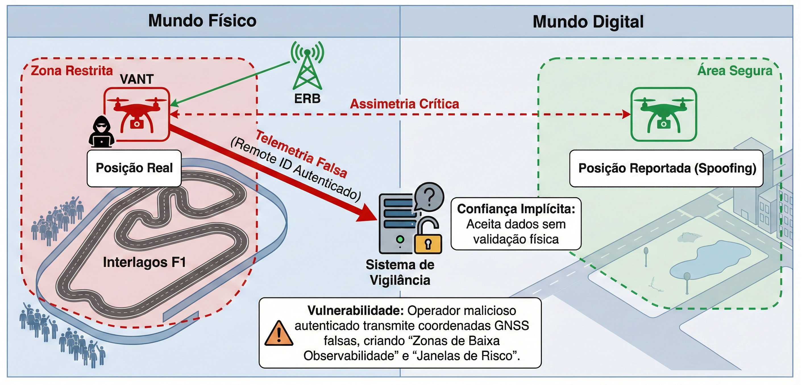

# _Digital Shadows_: Detecção de _Spoofing_ de VANTs via Redes Celulares Oportunistas

**Repository for the experimental artifacts of the paper submitted to SBRC 2026.**


## 📋 Abstract

This project implements a **Cross-Layer Security Framework** designed to detect GPS Spoofing attacks in Unmanned Aerial Systems (UAS). Unlike traditional methods that rely on expensive primary radars, this approach leverages **Opportunistic Cellular Networks (5G)**.

By transforming existing Base Stations (gNB/eNB) into passive sniffers, the system validates the **Physical-Digital Consistency** of *Remote ID* packets. It compares the reported telemetry (Digital Layer) against the estimated location derived from RSSI and path-loss physics (Physical Layer) using a Trace-Driven simulation based on real infrastructure data from the **Interlagos F1 Circuit (São Paulo, Brazil)**.

## 🖼️ System Overview (Problem vs. Solution)

The approach addresses the **Critical Asymmetry** between the physical signal and the digital data. While *Remote ID* validates *who* is speaking, our system validates *where* the sender is physically located.


[cite_start]*> Figure 1: The attack scenario where an authenticated UAV reports a false position (Digital World) while occupying a restricted zone (Physical World), and the proposed detection via cellular infrastructure.*

## 📂 Repository Structure

The artifacts are organized to ensure reproducibility of the **SBRC 2025** results:

```text
├── data/
│   ├── raw/
│   │   └── Estacoes_SMP_interlagos.csv    # Real ANATEL dataset of cellular towers (TIM, CLARO, VIVO)
│   └── outputs/
│       ├── bucket_metrics_remoteid.csv    # Processed time-series metrics (N_detecting, RSSI, etc.)
│       └── top_15_risk_buckets.csv        # Identified "Risk Windows" (Blind spots > 15s)
│
├── src/
│   ├── simulation/
│   │   └── main_simulation.py             # Core logic: Path Loss Model, Spoofing Injection, epsilon calculation
│   ├── visualization/
│   │   ├── plot_risk_series.py            # Generates Figure 5 (Time Series Analysis)
│   │   └── generate_heatmap.py            # Generates the HTML coverage map
│
├── results/
│   ├── figures/                           # Generated PNGs for the paper
│   └── remoteid_heatmap_cobertura.html    # Interactive Folium map with GDOP/RSSI layers
│
├── requirements.txt                       # Python dependencies
└── README.md                              # This file

```

---

## 🚀 Key Features

* **Trace-Driven Simulation:** Uses real geolocation data of cellular towers (Lat/Lon/Height) to model the RF environment.
* **A2G Channel Modeling:** Implements Log-Distance Path Loss with Stochastic Shadowing () and antenna downtilt penalties.
* **Spoofing Injection Engine:** Simulates malicious actors injecting false GNSS coordinates to test detection robustness.
* **Consistency Algorithm ():** Calculates the normalized divergence between  and  to flag anomalies.
* **Risk Analysis:** Identifies "Risk Buckets" (Time windows where ) and correlates them with flight maneuvers.

---

## 🛠️ Installation & Usage

### Prerequisites

* Python 3.8 or higher
* pip

### 1. Setup Environment

```bash
git clone [https://github.com/yourusername/sbrc2025-opportunistic-rid.git](https://github.com/yourusername/sbrc2025-opportunistic-rid.git)
cd sbrc2025-opportunistic-rid
pip install -r requirements.txt

```

### 2. Run the Simulation

Execute the main script to process the flight paths, inject attacks, and calculate metrics.

```bash
python src/simulation/main_simulation.py

```

*Output:* This will generate `bucket_metrics_remoteid.csv` in the data folder.

### 3. Generate Visualizations (Reproducing Paper Figures)

**To generate the Time Series Risk Analysis (Figure 5 in the paper):**

```bash
python src/visualization/plot_risk_series.py

```

*Output:* `results/figures/figura5_serie_temporal_risco.png`

**To generate the Interactive Heatmap:**

```bash
python src/visualization/generate_heatmap.py

```

*Output:* `results/remoteid_heatmap_cobertura.html` (Open this file in any web browser).

---

## 📊 Methodology & Models

### 1. Path Loss Model (Log-Distance Shadowing)

The Received Signal Strength Indicator (RSSI) is estimated using the following link budget equation, adapted for urban/suburban Air-to-Ground (A2G) channels:

$$ P_{rx}(d) = P_{tx} + G_{sys} - \left( PL(d_0) + 10\eta \log_{10}\left(\frac{d}{d_0}\right) + X_{\sigma} + L_{clutter} \right) $$

Where:

* : Path Loss Exponent (Suburban/Vegetation).
* : Log-normal Shadowing.
* : Additional loss due to antenna downtilt and static obstructions.

### 2. Physical-Digital Consistency ()

Spoofing is detected when the physical reality (RSSI) contradicts the digital claim (GPS). An alert is raised if:

$$ \epsilon = \frac{|d_{RSSI} - d_{GPS}|}{d_{GPS}} \ge \tau $$

Where  is the empirically determined decision threshold.

---

## 📈 Results Summary

The experiment evaluated the coverage and detection capabilities in the Interlagos Circuit scenario:

| Metric | Result (Combined Scenario) | Note |
| --- | --- | --- |
| **Precision** | **71.94%** | High reliability for triggered alerts (Low False Alarm rate). |
| **Recall** | **15.70%** | Limited by RF shadowing and antenna downtilt (blind spots). |
| **Max Outage** | **~1 Hour** | Critical vulnerability identified in flight `F6Z9...33B85`. |

*Full analysis available in the SBRC 2025 paper.*

---

## 🤝 Citation

If you use this code or dataset in your research, please cite our **SBRC 2025** paper:

```bibtex
@inproceedings{souza2025sbrc,
  title={Além do Remote ID: Verificação de Consistência Físico-Digital de VANTs via Redes Celulares Oportunistas},
  author={Souza, Flavio L. S. and Ribeiro, Carlos H. C. and Gurtov, Andrei and Junior, Lourenço A. P.},
  booktitle={Anais do XLIII Simpósio Brasileiro de Redes de Computadores e Sistemas Distribuídos (SBRC)},
  year={2025},
  publisher={SBC},
  address={Brazil}
}

```

---

## 📝 License

This project is licensed under the MIT License - see the [LICENSE](https://www.google.com/search?q=LICENSE) file for details.

## 📧 Contact

* **Flavio L. S. Souza** - flavio.souza@ga.ita.br
* **Instituto Tecnológico de Aeronáutica (ITA)**

```

```